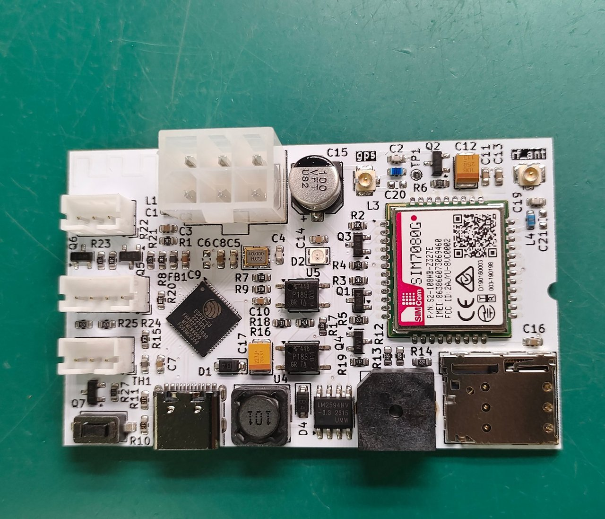

# VMflow NuttX

[](https://github.com/nodestark/vmflow-nuttx/actions/workflows/build.yml)
[](https://github.com/apache/nuttx/releases/tag/nuttx-13.1.0)
[](https://www.espressif.com/en/products/socs/esp32-s3)
[](#sim7080g-lte-m--nb-iot)
[](docker/Dockerfile)
[](LICENSE)
[](https://github.com/nodestark/vmflow-nuttx/commits/main)

NuttX port of the [VMflow](https://github.com/nodestark/mdb-esp32-cashless) MDB cashless
firmware for the ESP32-S3.

> **Status** — bring-up. NuttX boots with an NSH console on the chip's native USB port
> (USB-Serial/JTAG). The SIM7080G comes up as a regular network interface (`ppp0`) through
> pppd, so sockets, DNS and HTTP go over LTE-M/NB-IoT. The `mdb` engine answers the vending
> machine as an MDB cashless device, and any task opens sessions and approves vends through it.
> The `vmflow` orchestrator ties them to the VMflow backend (signed MQTT RPC: credit, dex, info,
> ...; sales) and to the phone app over BLE (provisioning, app sessions, vend notifications).
> The WS2812 status LED and the buzzer follow the ESP-IDF firmware, and `dex` reads the
> machine's EVA-DTS audit. Not ported: Wi-Fi, OTA and the PAX counter.



[](https://www.pcbway.com/project/shareproject/MDB_ESP32_GPS_LTE_M_NB_IoT_Cashless_Device_05cc1976.html)

Related projects:

- [mdb-esp32-cashless](https://github.com/nodestark/mdb-esp32-cashless): the ESP-IDF
  firmware this port follows, with the hardware (KiCad), backend and Android app.
- [vmflow-cli](https://github.com/nodestark/vmflow-cli): command line for the VMflow fleet
  (auth, device RPC over MQTT, sales, telemetry).

## Layout

```
.
├── nuttx/                    apache/nuttx      (submodule, nuttx-13.1.0)
├── apps/                     apache/nuttx-apps (submodule, nuttx-13.1.0)
├── firmware/
│   ├── apps/                 VMflow applications, linked as apps/external
│   │   ├── vmflow/           orchestrator: MQTT RPC, BLE (NimBLE), LED, buzzer
│   │   ├── mdb/              MDB cashless engine and its client API (`mdb` command, mdb.h)
│   │   ├── sim7080g/         modem daemon: power, pppd, link supervision
│   │   ├── rgbled/           `rgbled` command for the WS2812 status LED
│   │   └── dex/              `dex` command: EVA-DTS audit over DDCMP or DEX/UCS
│   └── boards/vmflow-esp32s3/
│       ├── src/              board code (derived from esp32s3-devkit), PWRKEY GPIO, RGB LED,
│       │                     MDB bus driver
│       └── configs/
│           ├── vmflow/       default: NSH on USB-Serial/JTAG, SIM7080G + PPP
│           └── vmflow-otg/   alternative: NSH on USB-OTG CDC-ACM
├── docs/                     board photo
├── docker/Dockerfile         build environment (xtensa-esp-elf 14.2.0, esptool 5.2.0, kconfig)
└── Makefile                  build, flash and monitor through Docker
```

## Build

Requires Docker. Everything else lives in the image.

```bash
git clone --recurse-submodules --shallow-submodules https://github.com/nodestark/vmflow-nuttx
cd vmflow-nuttx

make image       # toolchain image (once)
make configure   # apply firmware/boards/vmflow-esp32s3/configs/vmflow
make build       # -> nuttx/nuttx.bin
```

`--shallow-submodules` fetches only the pinned NuttX snapshot (~300 MB of git data) instead of the full
history. For a clone made without it:

```bash
git submodule update --init --depth 1
```

The first build clones Espressif's `esp-hal-3rdparty` into the NuttX tree, so it needs
network access.

Behind a TLS-inspecting proxy, `make image` forwards the host CA store
(`/usr/local/share/ca-certificates`) into the image. Point `EXTRA_CA_DIR` elsewhere if
your certificates live in another directory.

## Flash and console

```bash
make flash               # PORT=/dev/ttyACM0 by default
make monitor             # NSH console, exit with Ctrl+] (close it before flashing)
```

```
nsh> vmflow
VMflow on NuttX 13.1.0 (xtensa)
build: 2b5c0de5 Oct 23 2026 13:11:50
nsh> uname -a
NuttX 13.1.0 2b5c0de5 Oct 23 2026 13:11:50 xtensa esp32s3-devkit
```

If the console stays silent after `make flash`, the chip did not leave download mode on
the final reset; replug the board or press RESET.

Flashing and the console share the chip's native USB port (GPIO19/20), which shows up as
`303a:1001` Espressif USB JTAG/serial in both download mode and while NuttX runs.

On the USB-Serial/JTAG, DTR and RTS drive the chip's BOOT and RESET lines: RTS high with
DTR low resets the chip, DTR high with RTS low pulls BOOT low. Linux raises both when the
port opens, which is harmless, so `make monitor` leaves them there. A terminal that then
drops DTR before RTS (miniterm's `--dtr 0 --rts 0`) passes through the reset state and
reboots the board on every open.

### USB-OTG console (`vmflow-otg`)

```bash
make configure build flash CONFIG=vmflow-otg
```

The console moves to the USB-OTG peripheral as a CDC-ACM device (`0525:a4a7` NuttX
CDC/ACM, marked experimental in NuttX). The port changes identity when NuttX starts, so
esptool can no longer reach the chip: to flash again, hold **BOOT** while plugging in. On a
VM, pass both USB IDs through.

## MDB

Two layers, as in the ESP-IDF firmware's `mdb_cashless_task()`, split so the bus has a single
owner:

- **Engine** (`mdb`, an nxinit service): the only task on the bus. It answers the VMC as a
  level 1 cashless device (address 0x10) and keeps the reader state.
- **Clients**: any task, script or NSH command. They queue requests for the engine (open a
  session with credit, approve or deny a vend, cancel) and can follow what happens on the bus.

```
 vmflow, scripts, `mdb credit 1.00`      mdb_request()      -> /mdb_cmd (mqueue)
 mdb engine                              state machine      -> /mdb_evt (mqueue)
 /dev/mdb0                               9-bit words, uint16_t per word, bit 8 = mode
 GPIO4 RX / GPIO5 TX                     bit-banged 9600 baud, falling-edge interrupt
```

```
nsh> mdb status
engine  : pid 7, up 53 s, /dev/mdb0, address 0x10, watchdog on
state   : idle, vmc level 2
session : funds 100, 16 s, idle 16 s
pending : credit 50, 14 s
bus     : 638 words, 274 frames for us, 0 bad, last 0 s ago, lost 0
totals  : sessions 1, vends 0, failed 0, cash 0
timeouts: approve 0, credits expired 0 (session 60 s, approve 8 s, bus 5 s, credit 120 s)
currency: 0xffff, scale 1, decimals 2 (amounts in cents)
nsh> mdb events 30
state idle
session_begin price 1.00 item 0
state enabled
session_end price 1.00 item 0
```

| Command | Use |
|---------|-----|
| `mdb` | run the engine in the foreground (what init does) |
| `mdb start` | spawn it in the background, when autostart is off |
| `mdb status` | reader state, session, the vend waiting for an answer, pending credit, bus counters |
| `mdb credit <amount>` | begin a session with that much credit (`1`, `1.5`, `1,50`) |
| `mdb open` | begin a session where every vend waits for `approve`/`deny` (app flow) |
| `mdb close` | cancel the session; with none open, drop the pending credit |
| `mdb approve`, `mdb deny` | answer the vend the VMC is asking for |
| `mdb oos` | answer the next poll with "command out of sequence" |
| `mdb events [s]` | print the engine's events for `s` seconds (60) |

From C, include `mdb.h` (`CFLAGS += ${INCDIR_PREFIX}$(APPDIR)/external/mdb`) and call
`mdb_request(MDB_CMD_SESSION_OPEN, 100)`; amounts are in cents, converted to the MDB scale
factor by the engine. The header is the whole client (the queues and structs are the contract),
so an app builds and runs whether the engine is configured or not; without it every call fails
with `ENOENT`.

Each process that wants events calls `mdb_subscribe()`: it creates `/mdb_evt.<pid>` and asks
the engine to copy every event there. The engine answers with a `snapshot` (state and session
funds), so a late or restarted client needs no history, then sends events as they happen.
Up to 4 subscribers; one whose queue is full misses events (counted as `dropped` in
`mdb status`), and one that exits is dropped. The engine forgets its subscribers when it
restarts, so a long-running client renews (`MDB_CMD_SUBSCRIBE` again) when its queue has been
quiet for a few seconds; each renewal is answered with a new snapshot.

How the engine behaves:

- Requests act on the VMC's next poll and only where the state allows: a session begins once
  the reader is enabled, so a credit sent before that waits as `pending` (credits add up).
- With credit, the engine approves a vend that fits the funds and denies one that does not;
  a failed vend gives the price back to the funds. An `open` session has no funds: each vend
  waits for `approve` or `deny`.
- On every (re)start the engine answers the first poll with JUST RESET, so a VMC that set the
  reader up before the reboot runs SETUP and READER ENABLE again.
- `session_end` carries the funds left unspent.
- Events go to one reader. Nobody may be reading, so a full queue (16) drops its oldest event.

Nothing waits forever, so neither the machine nor the engine stays stuck:

| Timeout | Default | What happens |
|---------|---------|--------------|
| `SESSION_TIMEOUT` | 60 s | a session with no vend activity is cancelled; each vend request and outcome restarts the count |
| `APPROVE_TIMEOUT` | 8 s | a vend in an `open` session with no `approve`/`deny` is denied |
| `RESPONSE_TIME` | 10 s | reported to the VMC in SETUP as the reader's maximum response time (ESP-IDF: 3 s); keep it above `APPROVE_TIMEOUT` |
| `BUS_TIMEOUT` | 5 s | no frame for the reader (machine off, cable out): the session ends (`session_end`, `bus_lost`), the reader drops to inactive and answers the VMC's next poll with JUST RESET |
| `CREDIT_TIMEOUT` | 120 s | a credit that found no session is dropped (`credit_expired`, so the sender can give it back); each new credit restarts the count |
| word gap | 20 ms | a word missing in the middle of a frame drops the frame instead of blocking on it |
| `WATCHDOG_TIMEOUT` | 10 s | the engine feeds MWDT0 (`/dev/watchdog0`) at least once a second; if it stops and init does not bring it back in time, the board resets |

`mdb status` shows the running timers (session idle time, vend wait, pending age, last frame) and
how often each timeout fired.

The bus is bit-banged like the ESP-IDF firmware: each received word is sampled inside the
falling-edge interrupt (~1.1 ms), and each sent word goes out with interrupts off. The VMC wants
an answer within 5 ms, so the engine runs at priority 200, replies before it reads its queue or
posts events, and does not log on the bus path (what happens goes to the event queues and
`mdb status`).

Settings live under **Application Configuration → VMflow → MDB cashless engine**: autostart,
address (cashless #1/#2), currency, scale factor, decimal places, the timeouts above and the
watchdog. The pins
are board options (`VMFLOW_MDB_RX_GPIO`, `VMFLOW_MDB_TX_GPIO`).

## SIM7080G (LTE-M / NB-IoT)

The modem is a boot service: nxinit starts `sim7080g` from `/etc/init.d/init.rc`
(`firmware/boards/vmflow-esp32s3/src/etc/init.d/init.rc`) next to the console, and `ppp0`
is up about 40 s after power-on with no command typed. Applications just open sockets.

```
nsh> ps
    4     4     0 100 RR       Task      - Waiting  Semaphore ... init_main
    5     5     4 100 RR       Task      - Running            ... sh
    6     6     4 100 RR       Task      - Waiting  Signal    ... sim7080g
    7     7     6 100 RR       Task      - Waiting  Semaphore ... pppd
nsh> sim7080g status
daemon  : pid 6, pppd pid 7
link    : up for 46 s
ip      : 100.82.56.6
apn     : lf.br, cmnb 3, tty /dev/ttyS1
nsh> nslookup mqtt.vmflow.xyz
Host: mqtt.vmflow.xyz Addr: 144.202.18.100
nsh> ping -c 2 google.com
56 bytes from 142.251.132.238: icmp_seq=0 time=190.0 ms
```

```
 app (MQTT, HTTP, OTA)    socket() as usual
 NuttX TCP/IP             routes, DNS
 ppp0                     TUN netdev (nuttx/net/tun.c)
 pppd                     apps/netutils/pppd: AHDLC, LCP, PAP, IPCP
 /dev/ttyS1               UART1, GPIO17 TX / GPIO18 RX, 115200
```

| Command | Use |
|---------|-----|
| `sim7080g` | run the daemon in the foreground (what init does) |
| `sim7080g start` | spawn it in the background, when autostart is off |
| `sim7080g status` | link state, address, drops, modem resets |

`CONFIG_SIM7080G_AUTOSTART` (default on) adds the service to `init.rc`; turn it off for
boards without a modem or SIM. init restarts the daemon 5 s after it exits, and a restarted
daemon reuses the running pppd.

The daemon mirrors `sim7080g_task()` from the ESP-IDF firmware:

1. Sends `+++` (a modem left in data mode by a previous run) and probes `AT`. A silent modem
   gets a PWRKEY pulse (`/dev/sim7080g_pwrkey`, GPIO14, 1.2 s).
2. Starts pppd in its own task. The connect script runs on every (re)connect: `ATE0`, `ATH`
   (drops a stale data call), `AT+CNMP=38`, `AT+CMNB=<mode>`, `AT+CGDCONT=1,"IP","<APN>"`,
   waits for `+CGATT: 1`, then `ATD*99#`. pppd retries it on its own until the modem is
   attached; IPCP sets the address, the default route and the operator's DNS servers.
3. Watches `ppp0`. With no address for `CONFIG_SIM7080G_LINK_TIMEOUT` seconds (300), it
   pulses PWRKEY to power-cycle a hung modem. The key toggles power, so a modem that was
   off comes back on the next window.

Settings live under **Application Configuration → VMflow → SIM7080G** (`make menuconfig`):
autostart, APN (`lf.br`), network mode (Cat-M / NB-IoT / both), serial device, link
timeout and PAP credentials. The PWRKEY pin is a board option (`VMFLOW_SIM7080G_PWRKEY_GPIO`).

Notes:

- `NET_TUN` is a BSD-licensed NuttX component, hence `CONFIG_ALLOW_BSD_COMPONENTS=y`.
- pppd only asks the peer for DNS servers when `IPCP_GET_PRI_DNS`/`IPCP_GET_SEC_DNS` are
  defined. `firmware/apps/sim7080g/Make.defs` adds them for the pppd build only, so the
  submodule stays untouched.
- `ppp0` MTU is 1024 (`CONFIG_NET_TUN_PKTSIZE`), matching pppd's 1024-byte buffers.
- pppd echoes the chat dialogue to the console; that output is hardwired in pppd.
- `kill` stops the daemon (`CONFIG_SIG_DEFAULT`, needed by NimBLE), and init starts it again
  5 s later.
- No CMUX: while PPP is up the modem takes no AT commands, same as the ESP-IDF firmware.
- pppd drops the link after sending `AHDLC_TX_OFFLINE` frames with nothing received. Upstream
  uses 5, which a few back-to-back TCP segments hit within one LTE-M round trip;
  `CONFIG_SIM7080G_PPP_TX_OFFLINE` (30) overrides it through `ppp_tuning.h`, force-included
  into the pppd build.
- TCP write buffers are on (`NET_TCP_WRITE_BUFFERS`, 64 IOBs). Without them every segment
  waits for its ACK and a non-blocking `send()` returns `EAGAIN`, which MQTT-C spins on.

## VMflow orchestrator

`vmflow` ties the backend and the phone app to the rest of the system, as the ESP-IDF firmware's
main loop does. It owns no hardware and only uses public interfaces, so it is optional: without
it the MDB engine, the modem and `dex` keep working.

```
 MQTT (mqtt.vmflow.xyz)          BLE (phone app)
            \                     /
              vmflow  (nxinit service)
   ┌──────────┬────────┴───┬──────────────┬──────────────┐
 mdb.h      "dex" command   /dev/gpio0     /dev/leds0     /data/vmflow/*
 (engine)   stdout -> file  (buzzer)       (status LED)   (identity)
```

### Identity

`subdomain` (the numeric device id, `<subdomain>.vmflow.xyz`) and `passkey` (RPC and BLE
signing key) are plain files on the LittleFS partition mounted at `/data`, in place of NVS:

```
nsh> mkdir /data/vmflow
nsh> echo 123 > /data/vmflow/subdomain
nsh> echo <passkey> > /data/vmflow/passkey
```

They are read whenever needed, so provisioning takes effect without a restart. The phone app
can also provision them over BLE, which, like the ESP-IDF firmware, only writes a value that is
not set yet. Until both exist the LED is white and MQTT does not connect. The passkey sits in
plain text on the flash, as in the ESP-IDF firmware's unencrypted NVS.

### MQTT

[MQTT-C](https://github.com/LiamBindle/MQTT-C) over plain TCP, set up like esp-mqtt in the
ESP-IDF firmware:

| | |
|-|-|
| broker | `mqtt.vmflow.xyz:1883`, anonymous, keepalive 120 s, clean session |
| client id | `vmflow-<subdomain>` |
| last will | `offline`, QoS 1, retained, on `domain.vmflow.xyz/<subdomain>/status` |
| on connect | publishes `online` (QoS 1, retained) there and subscribes `<subdomain>.vmflow.xyz/#` |
| reconnect | every 15 s; DNS or connect fail while `ppp0` is down, so it just waits for the link |

LTE-M has stalls of several seconds (and occasionally tens). MQTT-C resends any request still
unacknowledged after 30 s, so both acks may come back; the second one matches nothing and MQTT-C
reports `MQTT_ERROR_ACK_OF_UNKNOWN`, which would end the session. The client drops that error and
counts it as `late acks`.

### RPC

Signed commands on `<subdomain>.vmflow.xyz/rpc`, same wire format as the ESP-IDF firmware
(and `mdb-slave-esp32s3/tools/rpc.sh` there):

```
<cmd>:<args>:<ts>:<hmac>      hmac = HMAC-SHA256(passkey, "<cmd>:<args>:<ts>"), lowercase hex
```

`ts` must be within 10 s of the device clock, so nothing is accepted until NTP has set it.
Commands without an argument send `-`.

| Command | Action | Reply |
|---------|--------|-------|
| `credit:<cents>` | MDB session with that credit (`mdb_request`), beep | `.../rpc/confirm` `ok` |
| `oos:-` | "command out of sequence" on the next poll | `.../rpc/confirm` `ok` |
| `dex:-` | runs `dex`, publishes its stdout | `.../rpc/confirm` `ok`, then `.../rpc/dex` |
| `info:-` | device snapshot JSON (version, uptime, heap, `machine_state`, last sale, `ip_ppp`) | `.../rpc/info` |
| `echo:-` | liveness / RTT | `.../rpc/echo` `<ts>` |
| `buzzer:-` | 1 s beep | `.../rpc/confirm` `ok` |
| `restart:-` | reboot after the ack is out | `.../rpc/confirm` `ok` |

Reply topics are under `domain.vmflow.xyz/<subdomain>/`. `ota` is not ported. A `dex` with no
answer from the machine publishes nothing, as in the ESP-IDF firmware.

### Events published

From the engine's events, signed (`<msg>:<hmac>`) on `domain.vmflow.xyz/<subdomain>/...`, QoS 1:

| Event | Topic | Message |
|-------|-------|---------|
| `cash_sale` | `sale` | `<cents>:<item>:<ts>` |
| `vend_failure` | `vend_fail` | `<cents>,<item>:<ts>` |

As in the ESP-IDF firmware, cashless sales are not published here: the app reports them from
the BLE notifications.

### BLE

NimBLE peripheral over the HCI socket (NimBLE is built into `vmflow`), same GATT service and
characteristic as the ESP-IDF firmware (`b2bbc642-46da-11ed-b878-0242ac120002` /
`c9af9c76-46de-11ed-b878-0242ac120002`, read/write/notify). It advertises as
`<subdomain>.vmflow.xyz` (`0.vmflow.xyz` until installed).

| Write | Action |
|-------|--------|
| `00 <subdomain>` | provisioning, only while none is set |
| `01 <passkey>` | provisioning, only while none is set |
| `02` | MDB session with no fixed funds (every vend waits for an approval) |
| `03 <19-byte payload>` | approve the vend, signed and no older than 60 s |
| `04` | cancel the session |

Notifications (19 bytes: `cmd, price u32, item u16, time u32, 0 u32, HMAC[:4]`, big endian,
price in cents, HMAC-SHA256 with the passkey over the first 15 bytes): `0a` vend request, `0b`
vend success, `0c` vend failure, `0d` session complete. Wi-Fi provisioning (`06`/`07`) and the
PAX counter are not ported.

The BLE controller's network interface (`bnep0`) must be up for the HCI socket to carry
anything; `vmflow` brings it up before starting NimBLE.

### Status LED and buzzer

| LED | Meaning |
|-----|---------|
| white | not installed (no subdomain/passkey) |
| green | MQTT connected and the VMC has the reader enabled |
| magenta | MQTT only |
| blue | MDB only |
| red | neither |

The buzzer is GPIO12 through the NuttX GPIO driver, `/dev/gpio0` (`gpio -o 1 /dev/gpio0`);
`vmflow` beeps 1 s on `credit` and `buzzer`.

### Commands

```
nsh> vmflow status
vmflow  : NuttX 0.0.0, build 2b5c0de5 Oct 24 2026 16:15:13
daemon  : pid 11, device 123
machine : enabled, last sale item 0 price 0, 0 failed vends
mqtt    : connected for 44 s, broker mqtt.vmflow.xyz:1883
sessions: 1, failed attempts: 1
messages: rx 2, tx 3, late acks 0
ble     : advertising, name 123.vmflow.xyz, no connection
```

| Command | Use |
|---------|-----|
| `vmflow` | run it in the foreground (what init does) |
| `vmflow start` | spawn it in the background, when autostart is off |
| `vmflow status` | identity, machine view, MQTT and BLE state |
| `vmflow pub <topic> <msg> [qos] [retain]` | publish through the running session |

Settings live under **Application Configuration → VMflow → VMflow orchestrator**: autostart,
identity directory, device paths, the `dex` command, broker, buffers and BLE. The MQTT send
buffer (10 KB) holds every message until it is acknowledged, so a DEX audit goes out whole up to
that size.

## RGB LED

The board's addressable RGB LED (WS2812) sits on GPIO21. The bringup puts an RMT TX channel
on it and registers NuttX's WS2812 driver as `/dev/leds0`; the `rgbled` command drives it.

```
nsh> rgbled red              # solid color
nsh> rgbled 00ff00 20        # RRGGBB or #RRGGBB, 20 % brightness
nsh> rgbled blink blue 400 3 # 400 ms period, 3 blinks
nsh> rgbled rainbow 5 50     # color wheel for 5 s at 50 %
nsh> rgbled off
```

Colors by name: `off red green blue yellow cyan magenta white orange purple`. The LED holds
the last color written. Applications can write it directly: open `/dev/leds0` and write one
`uint32_t` per LED as `0x00RRGGBB` (the driver reorders it to GRB on the wire).

The pin is a board option (`VMFLOW_RGBLED_GPIO`); the command lives under
**Application Configuration → VMflow → RGB LED (WS2812)**.

## DEX (EVA-DTS audit)

`dex` reads the vending machine's audit through its DEX port, a port of `eva-dts.c` from the
ESP-IDF firmware. The port is UART2 on the same pins (GPIO9 TX, GPIO8 RX), `/dev/ttyS2`.

```
nsh> dex                     # DDCMP at 2400 baud, then DEX/UCS at 9600 if DDCMP got nothing
nsh> dex ddcmp               # only DDCMP
nsh> dex ucs                 # only DEX/UCS
nsh> dex > /tmp/audit.txt    # keep it in a file
nsh> cat /tmp/audit.txt
DXS*...
```

Only the audit goes to stdout; status lines (`dex: <n> bytes over DEX/UCS`,
`dex: no answer from the machine`) go to stderr and stay on the console when stdout is
redirected. `/tmp` is a tmpfs in RAM, cleared on reboot.

One read at a time: a `dex` started while another is running exits with
`dex: busy, another read is in progress`. The lock is a robust mutex, so a `dex` that dies mid-read
does not leave it held.

Differences from the ESP-IDF version:

- No MQTT publish; the output is plain text to use as needed.
- DEX/UCS only runs when DDCMP returned nothing; the ESP-IDF firmware always runs both.
- A silent line ends the read (the ESP-IDF loop kept reusing the last byte after a timeout), and a
  DDCMP message longer than the 1 KB receive buffer is rejected instead of overflowing it.

Settings live under **Application Configuration → VMflow → EVA-DTS audit reader**: serial device
and audit buffer size (8 KB).

## System services

Configured in the board's defconfig, used by the applications above:

| | |
|-|-|
| `/data` | LittleFS on the SPI flash (1 MB at 0x180000), formatted on first boot |
| NTP | `ntpcstart` from `init.rc`; polls `pool.ntp.org` over `ppp0` once the link is up |
| syslog | RAM buffer, read with `dmesg` (the USB-Serial/JTAG console has no low-level output, so the default channel showed nothing) |
| watchdog | MWDT0 (`/dev/watchdog0`), started and fed by the MDB engine |
| assert | a crash in an interrupt or kernel thread reboots at once (`BOARD_RESET_ON_ASSERT=1`); an asserting task is killed and init restarts it |

Known issues:

- After a reset by the hardware watchdog (`TG0WDT_SYS_RST`) the USB-Serial/JTAG console does not
  come back until a reset from esptool (`make flash`, or `esptool chip-id`). Software resets
  (`reboot`, the `restart` RPC, crashes) are not affected.
- `board_rmt_txinitialize() failed: -19` in `dmesg` is spurious: the NuttX function returns an
  uninitialized value when `DRIVERS_RC` is off. `/dev/leds0` is registered.
- `ntpcstatus` and the NTP daemon overflow the default 2 KB stack (a 1 KB host name buffer);
  both stacks are set to 4 KB.

## Configuration

```bash
make menuconfig      # edit nuttx/.config
make savedefconfig   # store it back into firmware/boards/vmflow-esp32s3/configs/<CONFIG>/defconfig
```

## Updating NuttX

`nuttx` and `apps` are pinned to the same release tag. To move both to a new release:

```bash
for m in nuttx apps; do
  git -C $m fetch --depth 1 origin tag nuttx-X.Y.Z
  git -C $m checkout nuttx-X.Y.Z
done
make configure build      # rebuild and test on the board
git add nuttx apps && git commit -m "build: bump NuttX to X.Y.Z"
```

Update the toolchain/esptool versions in `docker/Dockerfile` if the new release's
`tools/ci/docker/linux/Dockerfile` changed them.

## License

[MIT](LICENSE) for the VMflow code. NuttX, nuttx-apps and the board code derived from
`esp32s3-devkit` (`firmware/boards/vmflow-esp32s3`) are Apache-2.0.
